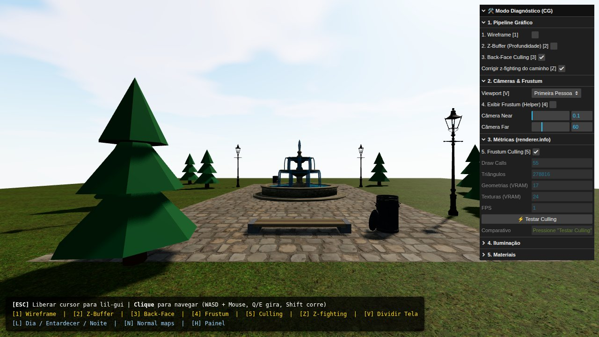
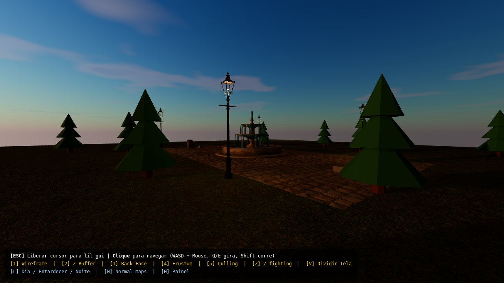
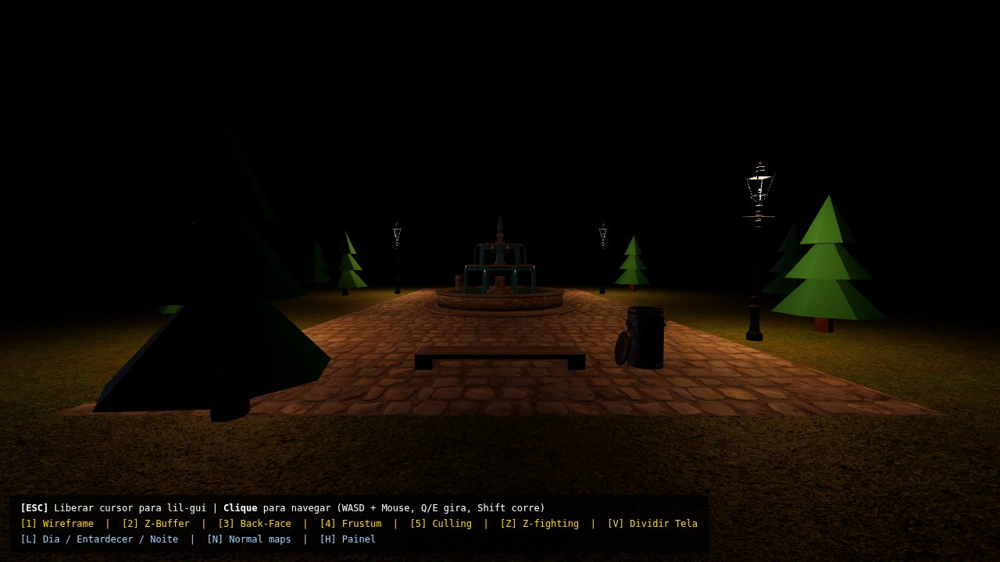
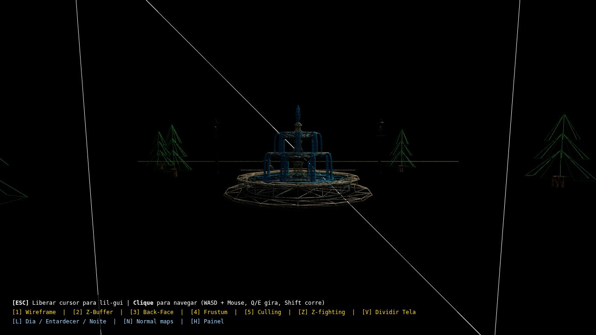
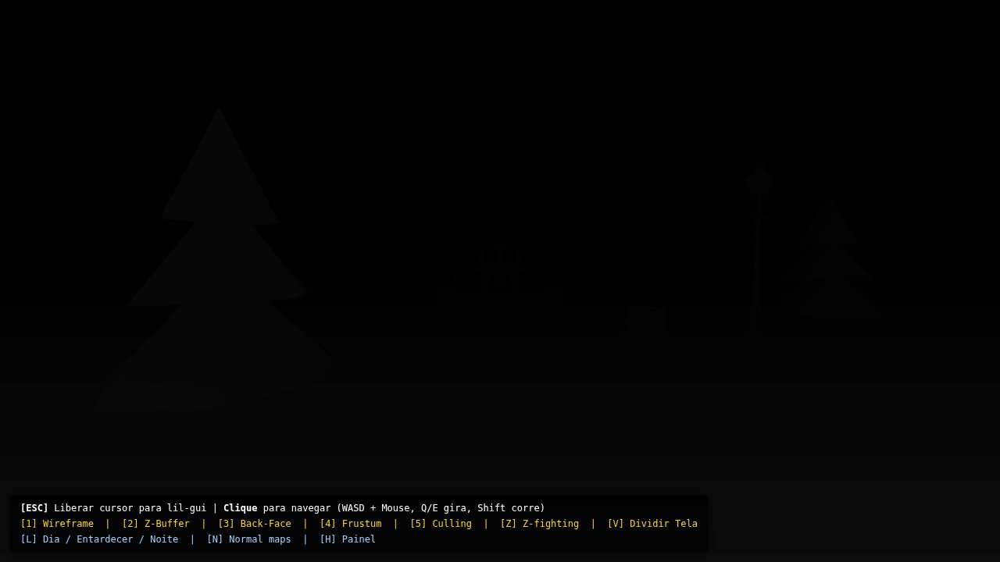
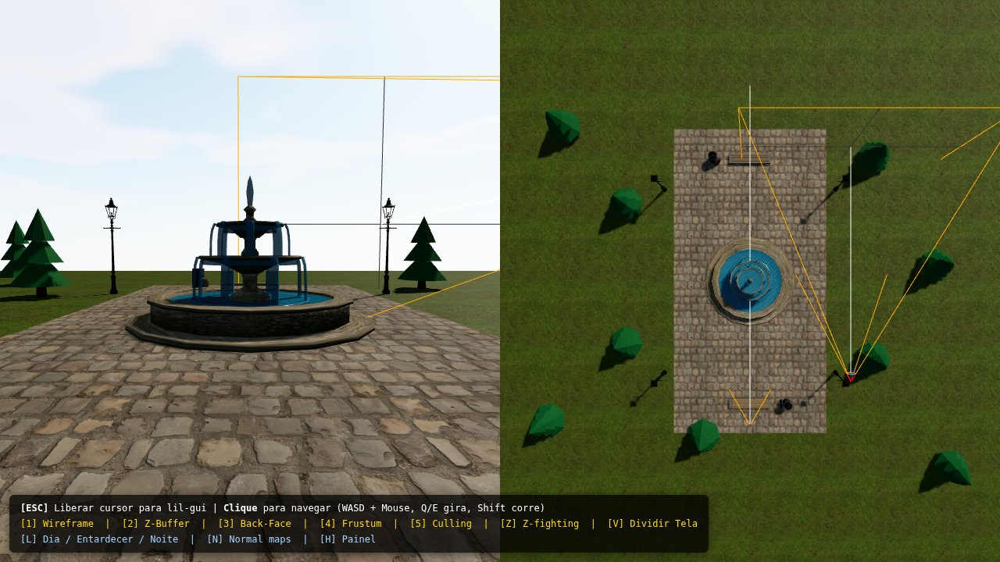
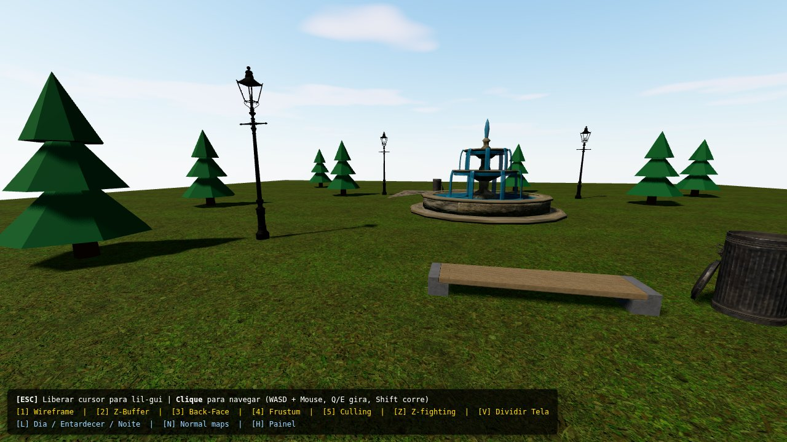
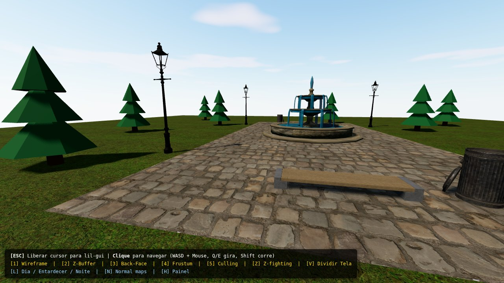

# Parque Urbano Navegável

Projeto prático de **Computação Gráfica** (Prof. Gabriel M. Alves, IFSP São João da Boa Vista, 2026): um mundo
explorável em Three.js de escopo pequeno — uma praça com chafariz, bancos, postes de luz, lixeiras e árvores — que
se percorre a pé, em primeira pessoa, de dia, ao entardecer e à noite.



## Vídeo de apresentação

[**docs/video.mp4**](docs/video.mp4) (80 s): navegação, texturas, os três formatos de modelo, dia → entardecer →
noite e o modo diagnóstico (wireframe, profundidade, viewport dividida e o caso de z-fighting).

O vídeo é gerado pelo próprio projeto: `?tour=1` liga um tour automático (`src/tour.js`) e
`ferramentas/gravar_video.py` grava quadro a quadro pelo Chromium sem janela e junta tudo com o ffmpeg. Cada quadro
é montado para um instante exato, então a velocidade do vídeo não depende do computador que grava.

## Como executar

```bash
npm install
npm run dev
```

Abra o endereço que o Vite mostrar (normalmente http://localhost:5173) e **clique na tela** para controlar a câmera.

### Controles

| Tecla           | Ação                                                     |
| --------------- | ---------------------------------------------------------- |
| Clique          | trava o mouse e começa a navegar                          |
| W A S D / setas | andar (3 m/s)                                              |
| Shift           | correr (6 m/s)                                             |
| Q / E           | girar para a esquerda / direita (90°/s)                   |
| Mouse           | olhar em volta                                             |
| Esc             | solta o mouse (para usar o painel)                         |
| 1               | wireframe                                                  |
| 2               | profundidade (z-buffer)                                    |
| 3               | back-face culling                                          |
| 4               | frustum da segunda câmera (CameraHelper)                  |
| 5               | frustum culling (compare os contadores do renderer.info)   |
| Z               | correção do z-fighting do caminho (caso de diagnóstico) |
| V               | viewport: primeira pessoa / dividida / visão de cima      |
| L               | iluminação: dia / entardecer / noite                     |
| N               | liga/desliga os normal maps                                |
| H               | mostra/esconde o painel                                    |

## Estrutura do código

| Arquivo                          | O que faz                                                                            |
| -------------------------------- | ------------------------------------------------------------------------------------ |
| `src/main.js`                  | cena, câmera, renderizador, navegação e o laço de animação com `THREE.Timer` |
| `src/ambiente.js`              | céu, neblina, grama, caminho de pedra e os materiais do chafariz (pedra e água)    |
| `src/iluminacao.js`            | luzes (sol, hemisférica e postes), presets e o painel de iluminação               |
| `src/materiais.js`             | carregamento das texturas PBR e o normal map procedural da água                     |
| `src/loadModels.js`            | modelos 3D em GLB, OBJ + MTL e FBX                                                   |
| `src/diagnostics.js`           | modo diagnóstico do pipeline (os 5 itens do requisito 3.3 e o caso de profundidade) |
| `src/tour.js`                  | tour automático com legendas, usado para gravar o vídeo (`?tour=1`)              |
| `ferramentas/gltf_para_obj.py` | conversão da lixeira de glTF para OBJ + MTL (ver Créditos)                         |
| `ferramentas/gravar_video.py`  | grava o vídeo a partir do tour (Chromium sem janela + ffmpeg)                       |

## Decisões técnicas

### Câmera

`PerspectiveCamera` com campo de visão vertical de **75°**, perto da visão humana sem distorcer as bordas, e olhos a
**1,7 m** do chão. O **near = 0,1 m** é perto o bastante para não cortar o banco quando se chega junto dele e
longe o bastante para não desperdiçar a precisão do z-buffer, que é **não linear** e se concentra perto do near.
O **far = 60 m** cobre o parque de 50 m de ponta a ponta; o resto é escondido pela neblina, que começa em 30 m.
Os dois valores podem ser mudados no painel para ver o efeito (ver o caso de diagnóstico).

### Navegação independente da taxa de quadros

As velocidades são definidas **por segundo** (andar 3 m/s, correr 6 m/s, girar 90°/s) e multiplicadas pelo tempo
do quadro. O tempo vem do `THREE.Timer`: `timer.update()` é chamado **uma vez por quadro, antes** de
`timer.getDelta()`. Assim, 1 s de tecla apertada anda 3 m a 30 ou a 144 quadros por segundo. O delta é limitado a
0,1 s para que uma travada (aba em segundo plano) não "teleporte" a câmera, e `timer.connect(document)` pausa o
tempo com a aba oculta. A água do chafariz também se move em unidades por segundo.

### Iluminação

| Luz                                | Por quê                                                                                                                                                                | Parâmetros                                                                                                                                                                                                                          |
| ---------------------------------- | ----------------------------------------------------------------------------------------------------------------------------------------------------------------------- | ------------------------------------------------------------------------------------------------------------------------------------------------------------------------------------------------------------------------------------ |
| `DirectionalLight` (sol)         | raios paralelos, como os do sol; é a **única que projeta sombra**, porque a sombra direcional usa um só mapa (câmera ortográfica), a mais barata             | sombra 2048 × 2048 sobre um frustum de ±26 m ajustado ao parque (cada texel cobre ~2,5 cm, sombras nítidas); `bias -0,0005` e `normalBias 0,02` contra o *shadow acne*; filtro PCF com `radius 3` para uma penumbra suave |
| `HemisphereLight` (céu e chão) | no lugar da `AmbientLight`, que deixa tudo chapado: ilumina de cima com a cor do céu e de baixo com a cor da grama, imitando a luz rebatida nas laterais dos objetos | intensidade e cores mudam com o momento do dia                                                                                                                                                                                       |
| `PointLight` (4 postes)          | luz que sai da lâmpada em todas as direções e cai com o inverso do quadrado da distância (`decay 2`); cor quente (~2700 K)                                        | **sem sombra de propósito**: a sombra de uma PointLight usa 6 mapas (um cubo), então seriam 24 renderizações extras por quadro com 4 postes                                                                                |

O céu (`Sky`, espalhamento atmosférico) usa a mesma posição do sol que a luz direcional, então céu e luz combinam.
Os presets mudam tudo junto: no **Dia** o sol fica alto e os postes desligados; no **Entardecer** o sol fica rasante
e alaranjado e os postes acendem fracos; à **Noite** o sol vai para baixo do horizonte (e para de fazer sombra) e os
postes iluminam o caminho. O renderizador usa *tone mapping* ACES, porque as luzes são físicas (o sol passa de 1)
e a cena tem mais brilho do que a tela mostra; a exposição é ajustada em cada preset.

| Entardecer                             | Noite                        |
| -------------------------------------- | ---------------------------- |
|  |  |

### Materiais e texturas

Todos os materiais são `MeshStandardMaterial` (PBR), para os modelos de origens diferentes reagirem à luz do
mesmo jeito. Cada textura do chão tem três mapas: **cor** (em sRGB), **normal map** (convenção OpenGL, a mesma do
Three.js) e **rugosidade** (dados lineares; branco = áspero, preto = liso).

| Superfície      | Material                      | Detalhes                                                                                                                                                     |
| ---------------- | ----------------------------- | ------------------------------------------------------------------------------------------------------------------------------------------------------------ |
| Grama            | `leafy_grass`               | repetida 12× sobre 50 m (≈ 4 m por repetição, o tamanho da foto); a `color` do material multiplica a textura e puxa para o verde de um gramado cuidado |
| Caminho          | `cobblestone_floor_01`      | repetida 3 × 6 no plano de 10 × 20 m, corrigindo a proporção (o UV vai de 0 a 1 nos dois eixos)                                                          |
| Chafariz (pedra) | `large_sandstone_blocks_01` | aplicada sobre as coordenadas UV do próprio modelo, que só tinha cores                                                                                     |
| Água            | normal map procedural         | gerado no código (soma de ondas senoidais) e deslocado com o tempo; rugosidade 0,08 para refletir o céu                                                    |
| Lixeira          | metal pintado                 | cor e normal map vêm do `.mtl`; rugosidade e metalicidade vêm do mapa ARM (canais G e B)                                                                 |
| Poste            | ferro fundido                 | cor, normal, rugosidade, metalicidade e um `alphaMap` que recorta as partes vazadas da luminária                                                          |
| Banco            | madeira e metal               | materiais PBR que vêm no próprio GLB                                                                                                                       |

A **anisotropia** (até 8×) deixa o chão nítido quando visto em ângulo raso, que é justamente o caso da primeira
pessoa. No painel (pasta *Materiais*, tecla N) dá para desligar os normal maps e mudar a rugosidade para comparar.

### Modelos 3D em três formatos

| Modelo                   | Formato                       | Por quê                                                                                                                                                                 |
| ------------------------ | ----------------------------- | ------------------------------------------------------------------------------------------------------------------------------------------------------------------------ |
| Banco, árvore, chafariz | **GLB** (glTF binário) | o formato da web: traz materiais PBR, texturas e hierarquia num arquivo só                                                                                              |
| Lixeira                  | **OBJ + MTL**           | o OBJ guarda só a geometria (vértices, UV, normais) e o MTL descreve o material; o `MTLLoader` gera `MeshPhongMaterial`, que trocamos por `MeshStandardMaterial` |
| Poste                    | **FBX**                 | formato comum em ferramentas 3D; o arquivo aponta para mapas `.exr`, que o `FBXLoader` não lê, então um `LoadingManager` troca para as versões `.jpg`        |

Os modelos que não vêm na escala real são ajustados pela altura (`Box3`): poste com 3,9 m e lixeira com 0,95 m.

### Grafo de cena

`Scene` → céu, grama, caminho, luzes (sol e seu alvo, hemisférica, 4 PointLights) e os modelos. Cada modelo é um
`Group` com suas malhas; os repetidos (2 bancos, 9 árvores, 2 lixeiras, 4 postes) são `clone(true)`, que
reaproveitam geometria e materiais na memória da GPU.

## Modo diagnóstico do pipeline

Painel lil-gui (canto superior direito) e atalhos de teclado:

1. **Wireframe** (`material.wireframe`): mostra as malhas e quantos triângulos cada objeto tem.
2. **Profundidade** (`scene.overrideMaterial = MeshDepthMaterial`): branco = perto, preto = longe.
3. **Back-face culling** (`material.side`): desligar faz as faces de trás também serem desenhadas.
4. **Frustum da segunda câmera** (`CameraHelper`): visível em 1ª pessoa, na viewport dividida e na visão de cima.
5. **Contadores do `renderer.info`** (chamadas de desenho, triângulos, geometrias e texturas), com e sem
   `frustumCulled`; o botão *Testar Culling* mede os dois casos no mesmo quadro.

| Wireframe                       | Profundidade                        | Viewport dividida com o frustum             |
| ------------------------------- | ----------------------------------- | ------------------------------------------- |
|  |  |  |

Na imagem de profundidade a cena fica quase toda escura mesmo estando a poucos metros: o z-buffer de uma câmera
em perspectiva **não é linear**. A profundidade gravada é proporcional a 1/z, então quase toda a precisão fica
perto do near (0,1 m) e tudo o que está a mais de alguns metros já tem valores muito próximos de 1. Aumentar o near
no painel distribui melhor a precisão e deixa a imagem mais contrastada.

## Caso de diagnóstico: z-fighting do caminho

**Problema.** O caminho de pedra é um plano no **mesmo nível da grama** (y = 0). Os dois têm exatamente a mesma
profundidade em cada pixel, e o z-buffer não tem como decidir qual está na frente: sobrevive quem é desenhado por
último, ou cada um em uma parte da tela conforme o arredondamento. Aqui a grama é desenhada depois e **o caminho
some** (em outros ângulos, aparecem listras que piscam ao andar). Desligue a correção com a tecla **Z** para ver.

**Correção.** `polygonOffset` no material do caminho (`factor -1`, `units -4`): a profundidade do caminho é
deslocada um pouco para perto da câmera **só no teste de profundidade**, sem mexer na geometria, e ele sempre vence.
A alternativa de levantar o caminho alguns milímetros também funciona, mas depende do near/far: com o near muito
pequeno ou o far muito grande a precisão longe da câmera não separa 1 cm, e o problema volta. O `polygonOffset`
trabalha nas unidades do próprio z-buffer, então vale para qualquer near/far.

| Antes (sem `polygonOffset`)   | Depois (com `polygonOffset`)    |
| ------------------------------- | --------------------------------- |
|  |  |

As imagens deste README foram geradas com parâmetros de URL (ex.: `?zfight=0&pos=1,1.7,-12&olhar=3,0,-3`; a lista
está no fim de `src/main.js`).

## Créditos e licenças

| Recurso                                                                                                              | Autor / fonte                                                                                                                | Licença  |
| -------------------------------------------------------------------------------------------------------------------- | ---------------------------------------------------------------------------------------------------------------------------- | --------- |
| Banco (`bench.glb`)                                                                                                | plaggy — [Sketchfab](https://sketchfab.com/3d-models/cc0-bench-096d4f915819409f9739326118bd5aa7)                             | CC BY 4.0 |
| Poste de rua (`street_lamp_01`, FBX)                                                                               | [Poly Haven](https://polyhaven.com/a/street_lamp_01)                                                                          | CC0       |
| Lixeira de metal (`metal_trash_can`)                                                                               | [Poly Haven](https://polyhaven.com/a/metal_trash_can); convertida de glTF para OBJ + MTL por `ferramentas/gltf_para_obj.py` | CC0       |
| Textura de grama (`leafy_grass`)                                                                                   | [Poly Haven](https://polyhaven.com/a/leafy_grass)                                                                             | CC0       |
| Textura do caminho (`cobblestone_floor_01`)                                                                        | [Poly Haven](https://polyhaven.com/a/cobblestone_floor_01)                                                                    | CC0       |
| Textura do chafariz (`large_sandstone_blocks_01`)                                                                  | [Poly Haven](https://polyhaven.com/a/large_sandstone_blocks_01)                                                               | CC0       |
| Three.js (e os addons `Sky`, `GLTFLoader`, `OBJLoader`, `MTLLoader`, `FBXLoader`, `PointerLockControls`) | [three.js](https://threejs.org)                                                                                               | MIT       |
| lil-gui                                                                                                              | [georgealways/lil-gui](https://github.com/georgealways/lil-gui)                                                               | MIT       |
| Vite                                                                                                                 | [vitejs](https://vitejs.dev)                                                                                                  | MIT       |

## Divisão do trabalho

| Integrante                  | Contribuições                                                                                                                                                            |
| --------------------------- | -------------------------------------------------------------------------------------------------------------------------------------------------------------------------- |
| João Vitor Gregorio Rumão | Estrutura inicial: cena base, terreno, navegação em primeira pessoa e carregamento dos modelos (M1)                                                                      |
| Pietro Turci Moraes Martins | Modo diagnóstico com lil-gui (M1); iluminação com presets e justificativas (M2); texturas, materiais PBR, modelos OBJ e FBX (M3); caso de diagnóstico de profundidade. |
| Rebeca Regina de Laia Papa  | Documentação sobre uso de IA e o desenvolvimento do README.                                                                                                              |

## Nota de transparência de IA

Ver [`utilizacao_IA.md`](utilizacao_IA.md).
